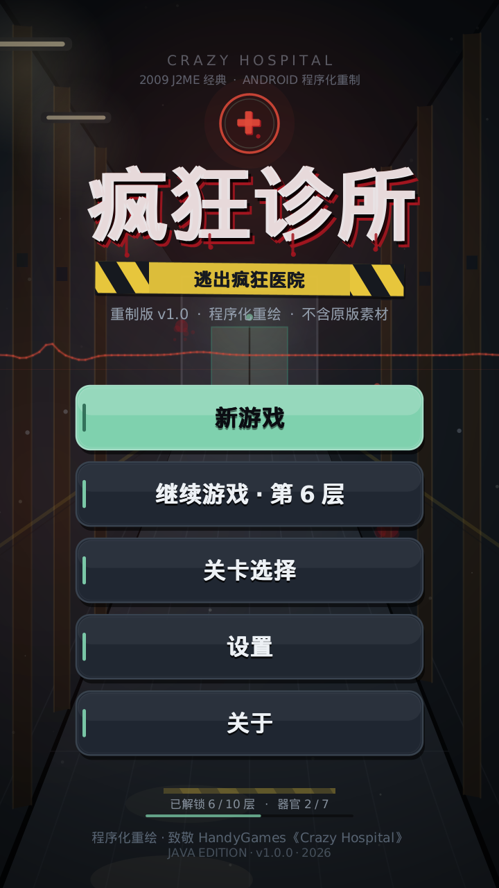
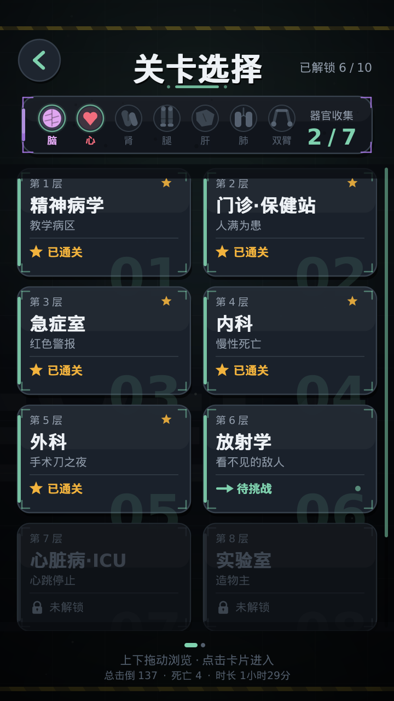
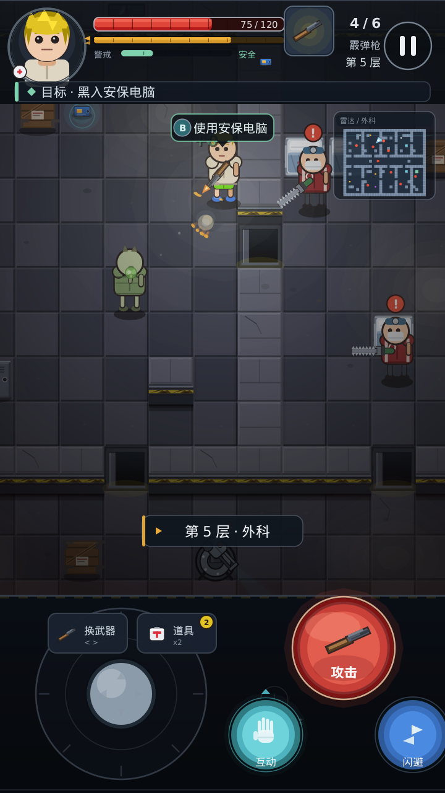
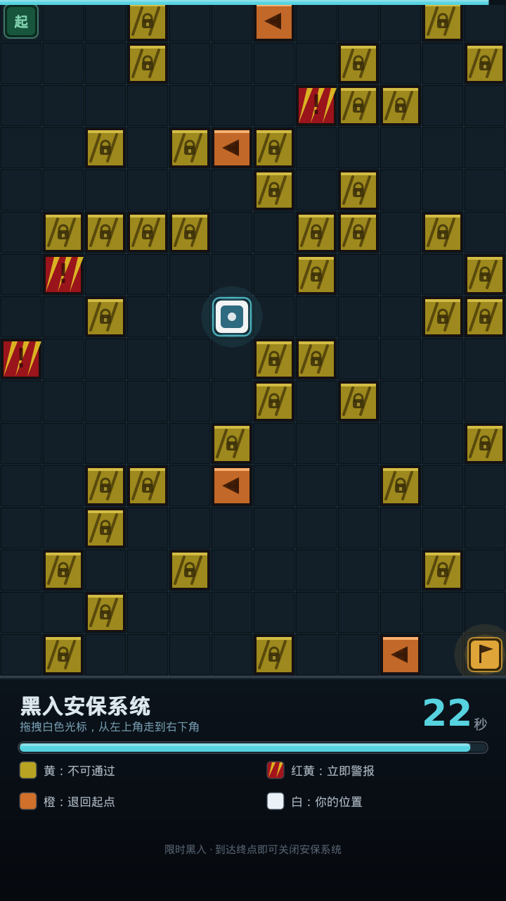
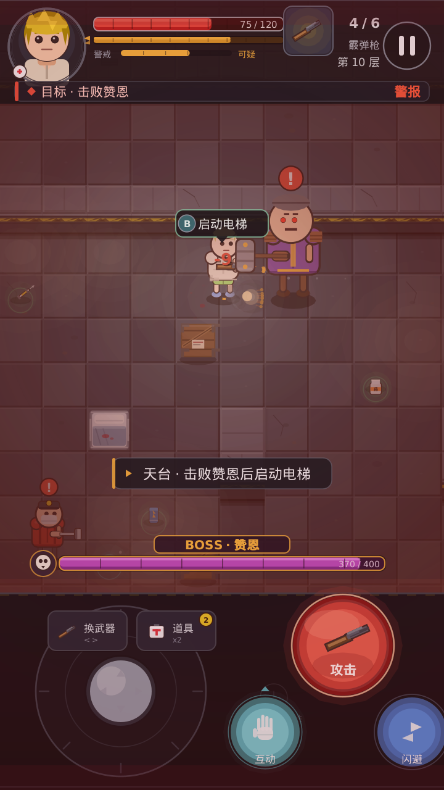
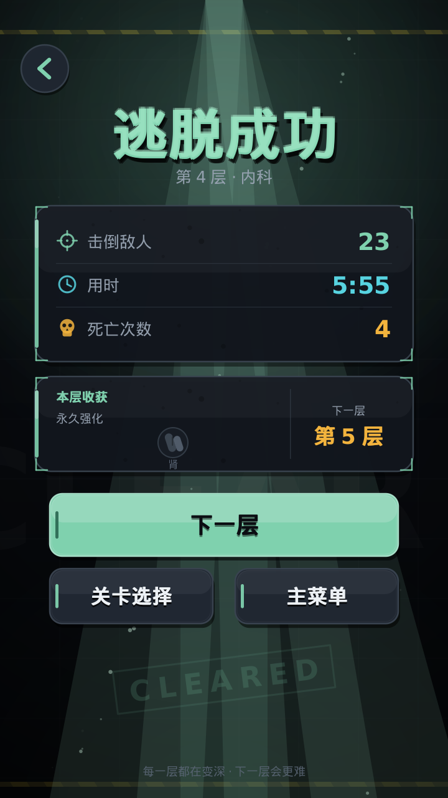
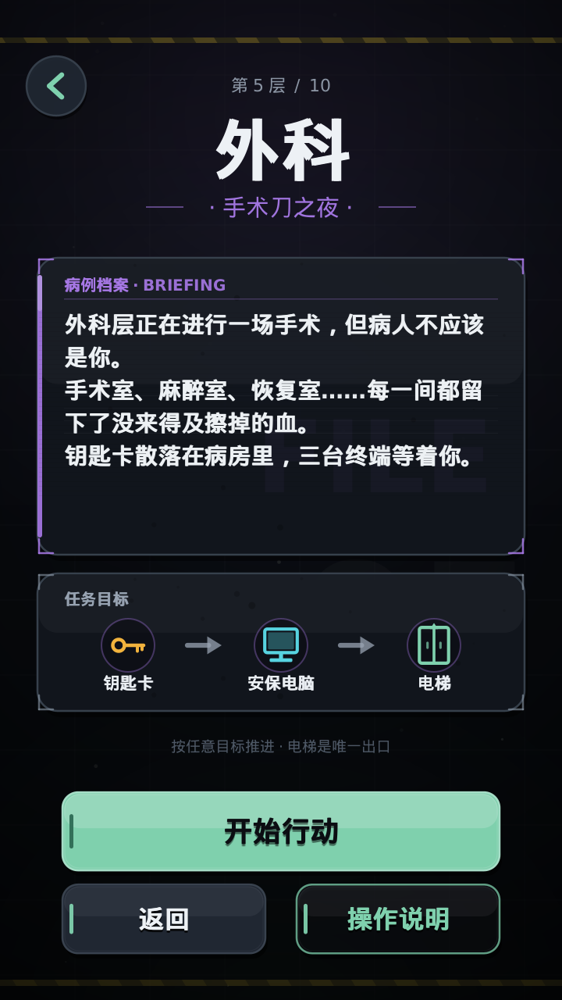
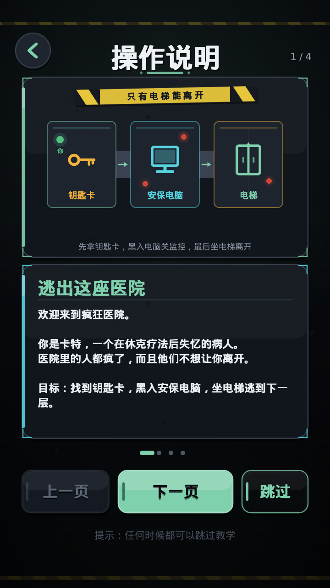
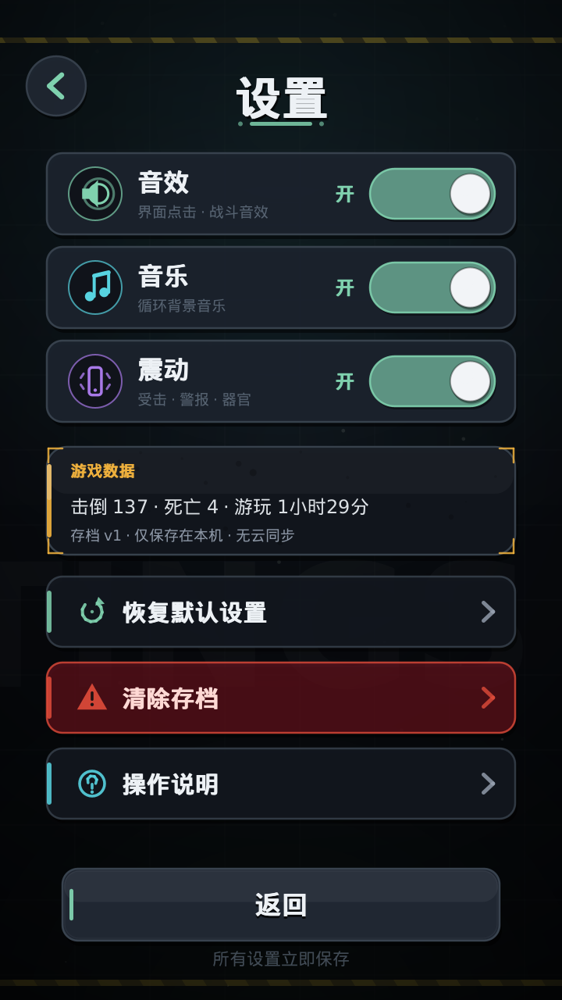

<div align="center">

# 疯狂诊所 · Crazy Clinic

### Java ME 时代经典手机游戏《疯狂诊所》的 Android 重制版

**俯视视角 · 动作潜行 · 程序化美术 · 纯 Java · 零第三方依赖**

[](https://developer.android.com)
[](https://openjdk.org)
[](LICENSE)
[](https://github.com/flykhan/crazy-clinic-android/actions/workflows/android.yml)
[](https://github.com/deepseek-ai/deepseek-harness)

[玩法](#玩法) · [截图](#截图) · [下载](#下载) · [构建](#从源码构建) · [架构](#技术架构) · [原版考证](#关于原版) · [致谢](#致谢)

</div>

---

## 这是什么

**《疯狂诊所》**（J2ME 时代国内渠道名）实为德国 **HandyGames** 2009 年的竖屏俯视角动作游戏 **《Crazy Hospital / 疯狂医院》** 的中国移动百宝箱中文版（net mobile AG 汉化，创艺和弦发行）。

本项目是它的**非商业同人重制版**：

- 忠实复刻原版核心玩法：**失忆病人卡特逐层逃出疯狂医院** —— 找钥匙卡、黑入安保电脑（限时迷宫小游戏）、躲避监控与警戒、坐单向电梯一层层向上逃；
- 保留原版 7 种敌人、8+1 种武器、8 种物品、7 种器官永久强化、15 个病区主题（收敛为 10 关）、最终 BOSS 赞恩与屋顶直升机结局；
- 针对触屏重做操作：**双虚拟摇杆 + 攻击/互动/闪避/换武器/道具**，并把 240×320 的 J2ME 画面 ×3 放大为 **720×1280** 的现代竖屏；
- **所有美术 100% 程序化绘制**（Android Canvas 图元，不含任何原版素材/位图），音效与 BGM 由脚本合成。

> 原版版权归 HandyGames 及其权利人所有。本项目仅为学习与怀旧，不包含任何原版资源，也不用于商业用途。

## 玩法

| 系统 | 内容 |
|---|---|
| 核心循环 | 探索病区 → 拾取武器/药品/器官 → 找钥匙卡开锁门 → 黑入安保电脑关闭监控与哨兵枪 → 坐电梯逃往下一层 |
| 潜行/战斗 | 巡逻、视野锥、警报、枪声引敌；偷袭或正面硬刚随你 |
| 敌人 | 看守人（扔扳钳）、医生（电锯）、护士（复活尸体）、感冒病人、中心助手（毒试管）、哨兵枪（固定炮台，怕电）、守卫、BOSS 赞恩（三阶段） |
| 武器 | 拳头、斧头、手术刀（可回收投掷）、手枪、霰弹枪、泰瑟枪、除颤器（EMP）、本生灯（火焰喷射）、爆炸试管 |
| 物品/器官 | 小/中/大医药包、止痛药、类固醇、能量饮料、红细胞生成素、隐形药；脑/心/肾/腿/肝/肺/双臂永久强化 |
| 骇客 | 12×16 限时迷宫：黄色阻挡、橙色退回起点、红黄立即失败并触发全图警报；成功后监控与炮台下线 |
| 关卡 | 10 层手绘病区：精神病学 → 门诊 → 急症室 → 内科 → 外科 → 放射学 → ICU → 实验室 → 总部 → 屋顶 |
| 存档 | 关卡解锁、器官收集、击杀/死亡统计、音效/音乐/震动设置 |

### 操作（触屏）

| 操作 | 手势 |
|---|---|
| 移动 | 左半屏拖拽摇杆（推满冲刺，消耗体力） |
| 瞄准/开火 | 右半屏拖拽（推过 55% 自动开火） |
| 攻击 | 右下红色按钮（按住连发） |
| 互动 | 开门 / 电脑 / 储物柜 / 电梯 / 拾取 |
| 闪避 | 0.35 秒无敌，消耗体力 |
| 换武器 / 道具 | 控制区左上两个按钮 |
| 暂停 | 世界区右上角 |

## 截图

> 全部截图由项目内的桌面预览工具（Java2D 渲染核心）自动生成，与 Android 端使用同一套游戏代码。

| 标题 | 关卡选择 | 游戏中 |
|---|---|---|
|  |  |  |
| **骇客小游戏** | **BOSS · 赞恩** | **结算** |
|  |  |  |
| **剧情简报** | **操作教学** | **设置** |
|  |  |  |

## 下载

前往 [**Releases**](https://github.com/flykhan/crazy-clinic-android/releases) 下载最新 `crazy-clinic-android-*.apk`，在 Android 8.0+ 设备上安装（需允许“安装未知来源应用”）。

APK 使用项目内置 release keystore 签名，可直接安装游玩。

## 从源码构建

环境：Linux/macOS，JDK 17，Android SDK（platform 34、build-tools 34.0.0），Gradle 8.7（自带 wrapper）。

```bash
git clone https://github.com/flykhan/crazy-clinic-android.git
cd crazy-clinic-android

# 指向你的 Android SDK
echo "sdk.dir=$ANDROID_HOME" > local.properties

./gradlew :app:assembleDebug --no-daemon
# 产物：app/build/outputs/apk/debug/app-debug.apk

# release（可选，需签名配置，见 app/build.gradle 的 CC_KEYSTORE 等环境变量）
./gradlew :app:assembleRelease --no-daemon
```

### 无模拟器验证：桌面截图

核心代码是纯 Java（无 Android 依赖），可在桌面用 Java2D 直接渲染并输出截图：

```bash
bash scripts/preview.sh   # 输出 720×1280 PNG 到 docs/screenshots/
```

## 技术架构

```
app/            Android 壳：SurfaceView 渲染线程、Canvas 渲染器、SoundPool/MediaPlayer 音频、SharedPreferences 存档
core/           纯 Java 17 游戏核心（可在 JVM 直接运行）
  world/        数据模型：World / Player / Enemy / TileMap / LevelDef / Pickup / Projectile / 粒子
  content/      数据驱动内容：10 层 ASCII 地图、数值平衡、中文文案
  game/         系统：移动碰撞、敌人 AI（BFS 寻路 + 视野）、战斗、警报、骇客小游戏、关卡流程
  render/       程序化渲染：医院场景、角色、特效、HUD、小地图
  ui/           菜单：标题、关卡选择、剧情、结算、设置、教学
tools/preview/  桌面 Java2D 渲染器 + 截图工具
tools/audio/    程序化 WAV 音效/BGM 生成脚本
```

- **逻辑分辨率 720×1280**，世界视口 720×960 + 底部 320 控制区；Android 端等比缩放 + 黑边适配。
- **零位图资源**：全部场景/角色/UI 由图元拼装；只有合成 WAV 音频。
- **每帧固定结算**：SurfaceView 独立线程，60Hz 固定步长更新。

## 关于原版

| 项 | 信息 |
|---|---|
| 原版名称 | Crazy Hospital /  Crazy Hospital (2009) |
| 开发/发行 | HandyGames（德国） |
| 中文版 | net mobile AG 汉化，创艺和弦 / 中国移动百宝箱渠道，国内名《疯狂诊所》 |
| 平台/分辨率 | Java ME (MIDP 2.0 / CLDC 1.0)，240×320 竖屏，单机 |
| 玩法 | 俯视 3/4 视角动作 + 潜行逃脱 |
| 版权 | 原版及其美术/音乐/文本 © HandyGames 及其权利人 |

本仓库**不包含**原版 JAR、图片、音频、文本或地图数据；研究资料仅保存在本地并被 `.gitignore` 排除。

## 致谢

- 原版游戏 HandyGames / net mobile AG / 创艺和弦；
- 本重制版由 **DeepSeek Harness 多智能体协作开发**：Lead（架构/集成/QA）、engine（玩法系统）、art（程序化美术）、ui（菜单界面）、level（关卡数值文案）、android（安卓平台/音频/预览）、researcher（原版逆向考证）；
- Java2D 截图渲染使用系统 CJK 字体。

## License

代码以 [MIT License](LICENSE) 开源。原版游戏相关内容版权归原权利人所有，本项目不主张任何相关权利。

---

<div align="center">

[](https://github.com/deepseek-ai/deepseek-harness)

用 **DeepSeek Harness** 多智能体协作完成：Lead 架构/集成/QA · engine 引擎 · art 美术 · ui 界面 · level 关卡 · android 安卓 · researcher 原版逆向

</div>
